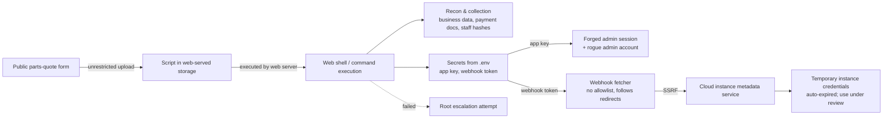

# Leading the Response to a Backoffice Compromise: From Web Shell to Cloud Credentials

*Author: LiveY — Open Intelligence Engineer / Security Manager. Anonymized portfolio case study. Purple-team + red-team lens. Draft.*

## Context

The platform I defend is a B2B dealer backoffice: a Laravel application on AWS that a motorcycle dealer network uses for sales, deposits, financing, warranties and parts quotes. It sits behind a public marketing/catalog site and integrates several third-party services (messaging, email, file storage, a financing partner, and an e-commerce catalog). Over roughly 72 hours in mid-October, an unauthorized external actor moved from an anonymous web form to command execution on the production host, and then pivoted toward the cloud control plane to harvest temporary credentials.

As Security Manager I owned the whole arc: triage, containment decisions, the remediation roadmap, team coordination and the message that went to non-technical stakeholders. Throughout I read the intrusion the way the attacker would — for each foothold, what does it unlock next, and could we even see it? — and converted every gap into a control with a test behind it.

## Business framing (stated carefully)

This is a backoffice that dealer staff rely on daily. The risks that mattered to the business were **availability** (could dealers keep working?), **trust/confidentiality** (customer PII — names, national IDs, vehicle identifiers, contact and financing data — plus three complete payment documents were within reach), and **integrity** (unauthorized writes). An important early finding that shaped my messaging: neither platform uses a payment gateway, so despite recon against payment settings, there was **no path to divert real payments**. I made sure leadership understood that distinction instead of panicking over the word "PayPal" in the logs.

## The attack chain (attacker-capability level, no PoCs)

1. **Upload → remote code execution.** A public parts-quote form forwarded attachments to the backoffice, which stored them in web-served storage keeping the client-supplied extension. After a short burst of probing submissions testing different extensions, the actor planted a server-side script in public storage that the web server executed, yielding command execution. A second, disguised web shell followed for durability.
2. **Reconnaissance & collection.** Using that access, the actor queried business data (sales, deposits, financing, warranties), copied payment documents to a temp folder, read application secrets, and dumped staff password hashes for offline cracking.
3. **Credential access & session forgery.** With the application key recovered from the host, the actor forged an administrator session rather than cracking a login, and created an unauthorized admin account.
4. **SSRF → cloud metadata.** The real pivot: a messaging webhook downloaded any attachment URL it was handed, with no host allowlist, following redirects. Having already lifted the webhook token from the host, the actor aimed that fetcher at internal services and at the cloud instance **metadata service**, retrieving **temporary instance credentials**. Those credentials carried a provider-set expiry and lapsed automatically; whether they were used before expiry was referred to the team that administers the cloud account for log review. Attempts to escalate to root on the host failed (the OS required a password).

### Attacker-side analysis I performed (red-team mindset)

- **Reused secrets from inside the host.** The `.env` held live integration credentials; from an RCE foothold these are immediately reusable, so I treated every integration secret as compromised and drove rotation rather than assuming segmentation would save us.
- **Lateral movement / deploy-key risk.** With host access and SSH material in scope, I flagged deploy keys and any trust the host held toward source control / deploy tooling as a realistic next hop, and scoped persistence review accordingly.
- **Credential/hash-reuse phishing risk.** Exfiltrated staff hashes plus a staff email list enable offline cracking and credential-stuffing or targeted phishing; I treated this as a people-risk, not only a systems-risk.
- **Limits of IP blocking vs. anonymizing networks.** The actor rotated through multiple source addresses, so I argued against leaning on IP blocklists as containment — against an actor using rotating/anonymizing egress, blocklists are speed bumps, not controls. Containment had to be at the capability layer (close the sink, rotate the secret, validate the token), not the address layer.

The post-incident review confirmed these points: the exposure is best treated as **capability materialized** (the actor *could* reach this data and these systems) rather than a proven line-by-line exfiltration inventory, because the host lacked full web-traffic logging and host auditing at the time.

## MITRE ATT&CK mapping

| Stage | Technique (ID) | Notes |
|---|---|---|
| Initial access | Exploit Public-Facing Application — T1190 | Unrestricted upload on a public form |
| Execution | Server Software Component: Web Shell — T1505.003 | Script executed from web-served storage; second disguised shell |
| Execution | Command and Scripting Interpreter — T1059 | Commands run via the web process |
| Persistence | Create Account — T1136 | Unauthorized admin account created |
| Credential access | Unsecured Credentials: Credentials in Files — T1552.001 | Integration secrets read from `.env` |
| Credential access | OS Credential Dumping — T1003 | Staff password hashes taken for offline cracking |
| Defense evasion / lateral | Use Alternate Authentication Material: Web Session Cookie — T1550.004 | Admin session forged from recovered app key |
| Discovery | Cloud Infrastructure / System Information Discovery — T1580 / T1082 | Recon of internal services and configuration |
| Credential access | Steal Application Access Token / Unsecured Credentials: Cloud Instance Metadata API — T1528 / T1552.005 | SSRF via webhook to the instance metadata service |
| Collection / Exfiltration | Data from Information Repositories; Exfiltration Over Web Service — T1213 / T1567 | Business data and payment documents staged/copied *(exfil volume unconfirmed)* |
| Privilege escalation (failed) | Abuse Elevation Control Mechanism: Sudo — T1548.003 | Root attempts failed; OS required a password |

## Crisis management across the mid-October window

**Day 1 (12th) — quiet entry.** Automated probing against a Laravel debug tool, then the upload burst that planted the script, early web-shell commands, and creation of the rogue admin account. Not yet detected.

**Day 2 (13th) — collection.** Business-data queries, payment documents copied, web shell exercised from several addresses.

**Day 3 (14th) — escalation, detection, containment.** Failed root attempts, the SSRF-to-metadata pivot, and a forged admin session. On detection I ran the response in a deliberate order: **preserve evidence first** (223 artifacts fingerprinted with verified hashes), **then** quarantine the web shell, block script execution in the affected storage paths, remove the unauthorized account (after preserving its record), pull the attacker's credential copies off the host, deploy the upload and webhook fixes, and rotate compromised credentials. Login attempts the rogue account made before its removal carried no privileged roles, and after the token check went live, every further webhook attempt was rejected.

**Leadership under pressure & trade-offs.** I enforced an **investigate-first governance rule**: no changes to the cloud account or ticketing without my explicit go, so we didn't destroy evidence or tip our hand while scoping. The hardest trade-off was *evidence vs. speed* — every hour the shell lived was risk, but cleaning before hashing would have blinded the investigation, so I preserved first and cleaned second, in minutes-not-hours windows. I also had to **separate confirmed facts from inference** publicly: I marked unverifiable claims (e.g., whether a prepared payment-settings script actually ran, whether temporary cloud credentials were used before expiry) as open, pending logs from the cloud-account administrators, rather than overstating the breach. Correcting an early internal over-claim (a dependency's benign post-install artifact had been mistaken for malware) cost credibility to fix but kept the report defensible.

**Communication to non-technical stakeholders.** I wrote the external/leadership summary in plain language around four headlines: *entry corrected, attacker access contained, data exposure bounded, payments never at risk.* I was explicit about what remained **in verification** (total volume sent off-host, pending cloud-provider log review) so nobody mistook "contained" for "nothing happened." Timeline was given in local time with a clear label, and I avoided jargon, exploit detail and any identifiers.

## Relative timeline

T+0 is the first malicious upload: the last of six probing submissions that left a server-side script in public storage (Day 1, the 12th). Offsets come from the incident record and the error-monitoring platform. All times are local (UTC-3), rounded to the minute.

| Relative time | Phase | What happened |
|---|---|---|
| T−12 h 34 min | Probing | Automated attempts against a Laravel debug tool, with no evidence of success. |
| **T+0** to T+2 min | Initial access | Six submissions to the parts-quote form testing different extensions. The last one plants the script. |
| T+43 min to T+48 min | Persistence | Second web shell, disguised as an application file, is installed. First commands run. |
| T+1 h 42 min | Persistence | Rogue admin account created, with no roles assigned. |
| T+16 h 54 min to T+17 h 56 min | Collection | Business-data queries. Three payment documents copied to a temp folder. Web shell used from several addresses. Payment-settings recon. |
| T+45 h 33 min to T+46 h 2 min | Escalation | Failed root attempts. Search for payment data and SSH keys. |
| T+45 h 41 min to T+45 h 43 min | Cloud pivot | Webhook SSRF toward internal services and the instance metadata service: 26 monitoring events in two minutes. |
| T+45 h 59 min | Session forgery | Admin session forged without a password. |
| T+46 h 2 min | Last attacker activity | Last observed web-shell use. |
| **T+47 h 1 min** | Response begins | Evidence preserved: 223 files with verified hashes, before any cleanup. This is the first recorded response action. |
| T+47 h 4 min | Containment | Attacker's copies of cloud credentials removed from the host. |
| T+47 h 42 min | Containment | Web shell quarantined. Script execution blocked in public storage. |
| T+48 h 31 min | Hardening | Additional web-server hardening, validated with 33 checks. |
| T+49 h 21 min | Validation | Last webhook attempt rejected by the token check. |
| T+49 h 40 min | Containment | Rogue account removed after preserving its record and history. |
| T+51 h 47 min | Expiry | Stolen temporary cloud credentials expire on the provider's own schedule. |
| Same day (Day 3) | Remediation phase 1 | Upload and webhook fixes deployed to production. Credentials rotated. E-commerce key replaced with a single read-only key. |
| T+65 h 34 min to T+67 h 34 min | Remediation | Upload validation hardened across public and internal forms. |
| Open | Verification | Cloud-provider log review for any pre-expiry credential use. |

## Metrics

| Metric | Value |
|---|---|
| Time to detect: first malicious upload → first recorded response action | **≈ 47 h** (upper bound; the exact detection minute isn't recorded) |
| Time to contain: first response action → last containment step (rogue account removed) | **2 h 39 min** |
| Attacker dwell time: first malicious upload → last observed web-shell use | **≈ 46 h** |
| Credentials rotated | Webhook token, application key (invalidates all sessions), messaging, email, file storage, broadcast and core credentials. The e-commerce key was reduced to a single read-only key. Two third-party integrations are still pending with their owners. |
| Artifacts preserved with verified hashes | **223** |

## Mitigation roadmap I own (first person) — each mapped to ATT&CK + the proving test

I organized remediation in three phases. Every item names the technique it blunts and the lab or regression test that proves it works — I don't accept a fix without a test that fails before and passes after.

### 1. Immediate containment (hours)

- **Close the entry.** I blocked script execution in public/upload storage and shipped server-side file validation. *Stops T1190 / T1505.003.* **Proof:** Pest `test_reject_php_upload` / `test_app_upload_rejects_php` (and related) in `lab/app`; infra check that private storage refuses to execute code.
- **Rotate credentials, assume-compromised.** I drove rotation of the application key (invalidating sessions), the webhook token, messaging/email/file-storage/e-commerce and core secrets, leaving e-commerce with a single read-only key. *Stops T1552.001 / T1550.004 (forged sessions die with the key).* **Proof:** coverage checklist test asserting each named secret was rotated and that old sessions/tokens are refused.
- **Preserve evidence before cleanup.** Hash-and-archive artifacts, then quarantine the web shell and remove the rogue account. *Supports detection of T1136 and the whole chain.* **Proof:** evidence manifest with verified hashes produced before any deletion step runs.

### 2. Short-term (days)

- **Private object storage for uploads.** Serve user files from non-executable, private storage via an authorizing controller or signed links; server-generated names and extensions. *Stops T1190 → T1505.003.* **Proof:** Pest `test_private_storage_not_under_webroot`, `test_download_allows_safe_basename`, `test_download_idor_blocked_for_other_owner`.
- **SSRF allowlist + no redirects + metadata block.** Outbound fetchers use a host allowlist, deny private/loopback/link-local ranges and the metadata address, disable redirect-following, and use short timeouts. *Stops T1528 / T1552.005.* **Proof:** unit tests with a data provider that rejects loopback, private ranges, the link-local metadata address, `file://` and redirect chains — failing before the helper exists.
- **IMDSv2 required.** Enforce session-oriented instance metadata so a blind SSRF cannot read credentials. *Stops T1552.005.* **Proof:** lab verification that an IMDSv1-style request without a session token returns no credentials.
- **Webhook token validation (fail-closed).** Reject any webhook call with a missing/mismatched token *before* any side effect, in every environment. *Stops the abused T1528 path.* **Proof:** test asserting an empty/invalid token yields rejection (not fail-open) ahead of any fetch.
- **Least privilege on API keys.** One revocable token per consumer, stored hashed; separate read vs. write scopes. *Reduces blast radius of T1552.001.* **Proof:** test that a read-scoped key cannot perform writes and that per-consumer revocation is isolated.

### 3. Long-term (weeks)

- **Immutable, centralized audit logs.** Ship web, auth and host audit logs off the host to append-only storage. *Counters T1070-style gaps and enables detection across the chain.* **Proof:** detection test that a planted indicator appears in centralized logs and cannot be edited in place.
- **Individual identities (no shared admin).** Per-person accounts and tokens so actions attribute to a human. *Counters T1136 / T1550.* **Proof:** access review test asserting no shared/privileged generic accounts remain.
- **Detect successful events, not only errors.** Alert on successful anomalous auth and actions (admin created, admin session from an unusual flow, secret-bearing writes, outbound calls to the metadata address), not just exceptions. *Detects T1136 / T1550.004 / T1552.005.* **Proof:** detection rules validated in the lab against replayed benign vs. malicious patterns.
- **Dependency review in CI.** Vulnerability scanning on lockfile changes with severity SLAs. *Reduces supply-chain and known-CVE exposure.* **Proof:** CI gate that fails on new critical/high findings without a tracked exception.
- **Threat model per PR.** A mandatory security checklist (untrusted input, authz, no debug tooling in prod, secrets, SSRF, fail-closed webhooks) before any change ships. *Systematizes prevention across techniques.* **Proof:** PR gate requiring the checklist and a negative security test for each security fix.

## Reproducible local lab

To make the lessons verifiable rather than anecdotal, a companion **Docker lab lives in `../../lab/`**. It runs a **Laravel 12** minimal backoffice (vulnerable `FIX=0` on :8081 vs fixed `FIX=1` on :8080) plus a **FAKE** metadata sidecar. Safely and locally it demonstrates: (a) unrestricted upload vs `StoreUploadRequest` / private `Storage::disk('local')`, (b) webhook SSRF to simulated `169.254.169.254` vs `SsrfGuard` + token middleware, (c) path jail and ownership policy against IDOR/traversal, and (d) **Pest** regressions (`./vendor/bin/pest --filter=LabSecurity`) named in the mitigation matrix (`test_reject_php_upload`, `test_ssrf_block_metadata_*`, `test_webhook_token_*`, `test_no_path_traversal_download`, `test_download_idor_blocked_for_other_owner`, and related). No real identifiers, secrets, or weaponized payloads — see `lab/README.md` and `lab/ATTACK_DEMO.md`. Run `composer install` inside `lab/app` (vendor is not shipped).

## Outcome

Entry corrected and validated; attacker access contained the same day; data exposure bounded; payments never exposed. Dealer operations were preserved with a brief, controlled database-access window as a precaution. The remaining open items — cloud-provider log review for any pre-expiry credential use, full host-persistence review, and the migration/hardening backlog — are tracked in the roadmap I own, with each control gated on a proving test.

## Lessons learned

Every lesson here comes from the roadmap above. None of them are new events.

- **I'd want logs before I need them.** The biggest limit on my conclusions was missing web-traffic logging and host auditing, so I had to describe the exposure as "capability materialized" instead of giving an exact exfiltration inventory. Centralized, append-only logs are now a baseline requirement, not a backlog item.
- **Alert on success, not only on errors.** The intrusion ran for two days before detection because nothing alerted on a *successful* admin creation, a forged admin session, or an outbound call to the metadata address. Detection rules now cover successful anomalous actions.
- **Untrusted input never lands somewhere executable.** Uploads go to private, non-executable storage with server-generated names. This is a design rule now, not something reviewers have to catch.
- **Every outbound fetcher is an SSRF sink until proven otherwise.** Allowlist, no redirects, block private/link-local ranges, require IMDSv2. Defense in depth means one missed check doesn't hand out cloud credentials.
- **Webhooks and secrets fail closed.** A missing token means rejection in every environment. Secrets on a compromised host count as burned, and rotation assumes compromise.
- **People need their own identities.** Shared admin access made attribution harder. Per-person accounts and per-consumer revocable keys make actions attributable and limit the blast radius.
- **Process changes:** a mandatory per-PR threat-model checklist, dependency scanning in CI with severity SLAs, and a rule that I don't accept a security fix without a test that fails before and passes after.
- **Communication:** keep confirmed facts separate from inference from the first message. Correcting an early over-claim cost credibility, so now I label anything unverified as open from the start.
