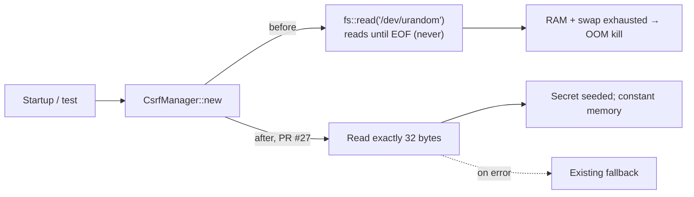

# Unbounded `/dev/urandom` Read in the CSRF Manager → Memory-Exhaustion DoS in int3rceptor

*Author: LiveY. First-person security finding and remediation. English. Status: fixed — PR #27 merged Oct 16, 2026.*

- **Project:** `S1b-Team/int3rceptor` — my own open-source intercepting proxy (public repository).
- **Change set:** PR #27 (https://github.com/S1b-Team/int3rceptor/pull/27)
- **Type:** Source-code security review + remediation (my own project)
- **Severity (honest rating):** **Medium (CVSS 5.5)**. Availability impact only. It triggers locally whenever a CSRF manager is created (e.g. at startup). There's no authentication bypass or data exposure, and a remote attacker can't trigger it on its own, so in practice it sits at the low end of Medium.
- **Status:** Fixed — PR #27 merged on Oct 16, 2026.

## Summary

| Field | Value |
|---|---|
| **Executive summary** | Creating int3rceptor's CSRF manager read `/dev/urandom` with no size limit and kept allocating until the process was OOM-killed. I changed it to a bounded 32-byte read, keeping the existing fallback. Fixed in PR #27. |
| **CVSS 3.1** | **5.5 (Medium)**: `CVSS:3.1/AV:L/AC:L/PR:L/UI:N/S:U/C:N/I:N/A:H` |
| **Affected component** | int3rceptor core: `CsrfManager::new` in `security.rs` |
| **Discovered** | Oct 16, 2026 (first fix commit and PR opened 09:57 UTC-3, after an OOM-killed test run) |
| **Fixed** | Oct 16, 2026, 10:23 UTC-3 (PR #27 merged) |
| **References** | https://github.com/S1b-Team/int3rceptor/pull/27 · CWE-400, CWE-770 · ATT&CK T1499 |

**CVSS justification (one line per metric):**
- **AV:L**: triggered by starting the process on the host. It isn't reachable over the network on its own.
- **AC:L**: deterministic. It happens every time a CSRF manager is created.
- **PR:L**: needs a local user able to start or restart the tool.
- **UI:N**: no extra interaction needed once the process starts.
- **S:U**: the impact is to this process. Host-wide memory pressure is a side effect, not a scope change I can show.
- **C:N / I:N**: no data read or modified.
- **A:H**: total loss of availability. The process exhausts RAM and swap and gets OOM-killed.

## Why this matters

CSRF protection is supposed to make the tool safer, not take it down. If constructing the security component itself can exhaust the host's memory, the proxy becomes unreliable exactly where it should be most boring — and on a shared or resource-constrained host, an OOM event can take neighbouring processes down with it.

## Finding

In int3rceptor core, `CsrfManager::new` (`security.rs`) seeded its secret with `std::fs::read("/dev/urandom")`. `fs::read` reads until end-of-file, but `/dev/urandom` is an endless device and never returns EOF. The call keeps allocating until memory runs out, so the process is OOM-killed whenever a CSRF manager is created (CWE-400 / CWE-770).

Observed in practice: a single CSRF test reached about 6 GB of RAM plus 12 GB of swap before the OOM killer stopped it.

## Fix

PR #27 reads **exactly 32 bytes** from `/dev/urandom` (bounded read) for the secret and keeps the existing fallback path unchanged. Memory use is now constant and the randomness source is the same.

## Tests

- Both CSRF tests, which previously hung and exhausted memory, now pass.
- Full core suite: **146 passed / 0 failed** after this and related fixes.

## Mapping

| Finding | CWE | ATT&CK |
|---|---|---|
| Unbounded read of an infinite device when seeding the CSRF secret | CWE-400 (Uncontrolled Resource Consumption), CWE-770 (Allocation of Resources Without Limits or Throttling) | T1499 (Endpoint Denial of Service) — impact class |

## Takeaway

"Read the whole file" is a reasonable default until the file has no end. Randomness sources should always be read with an explicit size. A one-line bounded read turned a guaranteed crash into a constant-memory operation, and the tests that used to take the host down now act as regression guards.
