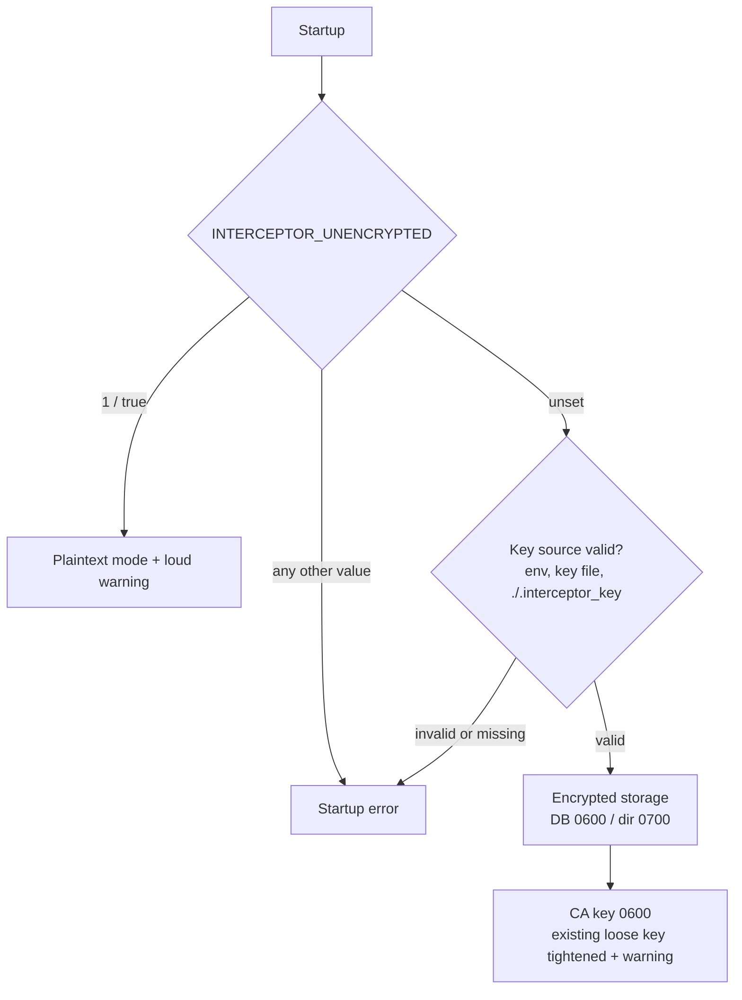

# Hardening Capture Storage Encryption and Key Handling in int3rceptor

*Author: LiveY. First-person security finding and remediation. English. Status: fixed — PR #26 merged Oct 16, 2026.*

- **Project:** `S1b-Team/int3rceptor` — my own open-source intercepting proxy (public repository).
- **Change set:** PR #26 — *Harden capture storage encryption and key handling* (https://github.com/S1b-Team/int3rceptor/pull/26)
- **Type:** Source-code security review + remediation (my own project)
- **Overall severity (honest rating):** **Medium** overall, with the **CA private-key exposure rated High on shared/multi-user hosts**.
- **Status:** Fixed — PR #26 merged on Oct 16, 2026, including follow-up review hardening (see below).

## Summary

| Field | Value |
|---|---|
| **Executive summary** | int3rceptor's capture storage could silently fall back to plaintext, and its CA private key was written with default permissions, readable by other local users. I made every path fail closed, loud and tested, and locked down key and database permissions. Fixed in PR #26. |
| **CVSS 3.1** | **6.1 (Medium)**: `CVSS:3.1/AV:L/AC:L/PR:L/UI:N/S:U/C:H/I:L/A:N` |
| **Affected component** | int3rceptor capture storage (encryption key resolution, capture DB) and CA key generation (`ca_key.pem`) |
| **Discovered** | Oct 16, 2026 (first fix commit and PR opened 09:43 UTC-3, my own source review) |
| **Fixed** | Oct 16, 2026, 10:40 UTC-3 (PR #26 merged) |
| **References** | https://github.com/S1b-Team/int3rceptor/pull/26 · `docs/STORAGE_ENCRYPTION.md` in the repo · CWE-311, CWE-636, CWE-732, CWE-1188, CWE-540, CWE-248 · ATT&CK T1552.004, T1557, T1552.001 |

**CVSS justification (one line per metric):**
- **AV:L**: exploitation needs a local account on the host running the proxy.
- **AC:L**: reading a world-readable key file or a plaintext DB takes no special conditions.
- **PR:L**: any unprivileged local user is enough. No admin or root needed.
- **UI:N**: the operator doesn't have to do anything beyond running the tool normally.
- **S:U**: the impact stays within the data and keys this tool manages.
- **C:H**: the CA private key and captured third-party secrets (cookies, tokens, API keys) are fully exposed.
- **I:L**: a stolen CA key enables certificate forgery, but tampering is limited to traffic from clients that trust this CA.
- **A:N**: no availability impact.

On shared or multi-user hosts I still treat the CA-key exposure as High in practice, because the environment raises its real-world impact. The base score stays Medium.

## Why this matters

int3rceptor is a security tool. Like any intercepting proxy it terminates TLS with its own CA and records the traffic it sees, so its capture store routinely holds other people's secrets — session cookies, bearer tokens, API keys, request bodies — and its on-disk CA private key is, by design, trusted by the browser for *every* site. A storage layer that can quietly fall back to plaintext, or a CA key that other local users can read, turns the defender's tool into the softest target on the box. For a tool whose whole value proposition is handling third-party secrets safely, "fail-open" is the wrong default. I reviewed my own capture-storage path with that lens and fixed it to fail closed.

## Findings

Confirmed in my review of the capture-storage and key-handling code:

1. **Plaintext flag checked only for presence (CWE-311, CWE-1188).** The plaintext switch was treated as "set or not," so `INTERCEPTOR_UNENCRYPTED=0`, `=false` or empty still disabled encryption. A deployment that *thought* it had opted out of plaintext was silently storing captures in the clear.
2. **Malformed encryption key silently ignored (CWE-636, fail-open).** An `INTERCEPTOR_ENCRYPTION_KEY` with the wrong length or bad hex was ignored and the code fell through — to a key file, or to plaintext — instead of stopping.
3. **No startup warning in plaintext mode.** Nothing told the operator that captures were being written unencrypted.
4. **Hex key parser could panic on non-ASCII input (CWE-248).** `from_hex` could panic rather than return an error, an availability and robustness problem in the trust-critical path.
5. **Default implementation fell back to plaintext on key errors.** The provider's `Default` impl quietly degraded to plaintext on any key error — a fail-open default baked into the type.
6. **Undecryptable fields returned empty with no error.** If a stored value couldn't be decrypted, the field came back empty with no signal, hiding key mismatches and corruption.
7. **`.interceptor_key` not gitignored (CWE-540 risk).** The local key file could be committed by accident, leaking key material into history.
8. **CA private key written with default permissions (CWE-732) — highest impact.** `ca_key.pem` was created with the process default umask, so on a shared host other local users could read it. Whoever reads that key can impersonate *any* site to the browser that trusts the CA — a full adversary-in-the-middle primitive. This is the finding I rate High in multi-user environments.
9. **Capture database created with default umask.** The capture DB (which holds the intercepted secrets) was created with default permissions rather than a locked-down mode.

### Noted but out of scope (tracked as follow-ups)

- **URL / query strings never encrypted.** Kept in plaintext today so filtering and search work; flagged as a known limitation to revisit.
- **No AEAD associated data binding.** Ciphertext isn't bound to its row/column, so encrypted values could in principle be swapped undetected; add AES-GCM associated data.
- **No key rotation / migration** between plaintext and encrypted databases.
- A docs/analysis inconsistency (the unencrypted-database finding) is now marked **fixed** with a pointer to the details.

## Fix (what I shipped in PR #26)

- **Strict flag parsing, fail-closed:** plaintext is enabled only for `1`/`true` (case-insensitive); any other value, including `0`, `false`, `yes` or empty, is a **startup error** — even when a key is also set.
- **Hard errors on bad keys:** an invalid env key, a missing/invalid key file, or an invalid `./.interceptor_key` now stops startup instead of falling through to plaintext.
- **Loud warning** logged at startup whenever storage runs unencrypted.
- **No panic on non-ASCII** hex input — `from_hex` returns an error; the key provider's `Debug` output no longer prints key material.
- **Removed the fail-open `Default` impl;** callers use explicit `with_key()` or `disabled()`. Testable key resolution via `KeySources` / `from_sources` without touching process env.
- **Decrypt failures are visible:** the entry is still returned, affected fields are empty, an `x-interceptor-decrypt-error` header is added, and a warning with the capture id is logged.
- **Locked-down permissions (Unix):** new DB directory `0700`, DB file `0600`; new CA directory `0700`, `ca_key.pem` `0600`; an existing world/other-readable CA key is tightened to `0600` at startup with a warning.
- **Repo hygiene & docs:** `.interceptor_key` added to both `.gitignore` files; new `docs/STORAGE_ENCRYPTION.md` (what is/isn't encrypted, key setup with `umask 077` + `openssl rand -hex 32`, resolution order, plaintext mode, decrypt-error handling, permissions, limitations); README updated.
- **Breaking changes called out:** previously-silent plaintext/invalid-key setups now fail at startup by design.

## Follow-up review hardening (before merge)

- **`KeySources` `Debug` output now redacts the raw key**, so key material can't leak through logs or panic messages when the key-resolution inputs are printed.
- **CodeQL "hard-coded cryptographic key" alerts triaged as false positives:** the flagged values are test fixtures and the placeholder used in explicitly disabled (plaintext) mode — neither is a real key used to protect data.

## Tests added (fail-before / pass-after)

Each fix has a test (storage, database and CA unit tests passed locally, 33/33):

| Fix | Proving test |
|---|---|
| Strict plaintext flag | invalid/empty `INTERCEPTOR_UNENCRYPTED` values are hard errors |
| Invalid env key / key file | bad key and missing key file are hard errors |
| Non-ASCII hex | `from_hex` returns error, no panic |
| No key leakage | `Debug` output excludes key material |
| Encrypted round trip | encrypt→decrypt works and no plaintext on disk |
| Decrypt-error signaling | wrong key produces the `x-interceptor-decrypt-error` marker |
| Plaintext semantics | `new_unencrypted` means plaintext and never reads env |
| Permissions | `0600`/`0700` on DB and CA directory + key |

*(Full workspace suite/build/clippy left to CI. A pre-existing, unrelated compile failure in the api crate's tests is documented in the PR, not introduced by it.)*

## ATT&CK & CWE mapping

| Finding | CWE | ATT&CK |
|---|---|---|
| CA private key readable by other local users | CWE-732 | T1552.004 (Private Keys), enabling T1557 (Adversary-in-the-Middle) |
| Silent plaintext fallback / flag-presence-only | CWE-311, CWE-1188, CWE-636 | T1552.001 (Credentials in Files) — captured third-party secrets left in clear |
| Capture DB / key file default permissions | CWE-732, CWE-276 | T1552.001 / T1552.004 (local read of stored secrets/keys) |
| `.interceptor_key` not gitignored | CWE-540 | T1552.001 (secrets in repo) |
| Panic on non-ASCII key | CWE-248 | availability / robustness of the trust-critical path |
| Undecryptable fields silently empty | CWE-636 | integrity/visibility gap (masks T1565-style tampering) |

## Takeaway

A security tool earns trust by being the *hardest* thing on the host, not the easiest. The theme across these findings was **fail-open defaults** — presence-only flags, silent plaintext fallback, default-umask key files. The remediation makes every one of them **fail closed, loud, and tested**, and the one that most deserved it (the readable CA key) is fixed and auto-tightened on existing installs.
